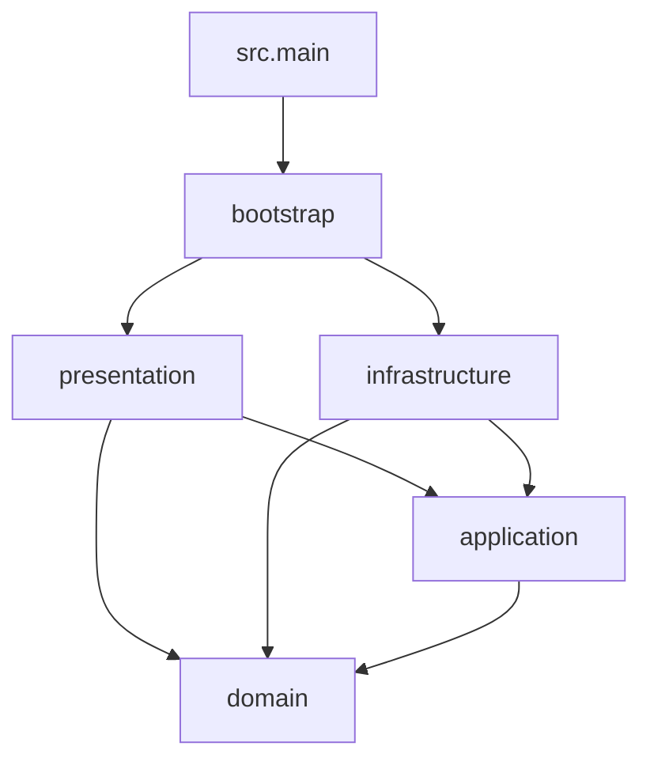
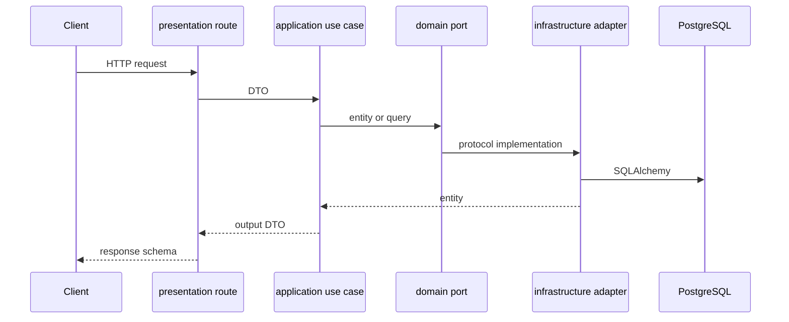

# Project structure

`payment_system` is a FastAPI service split into Clean Architecture layers.
The Python package is `src`. `uvicorn src.main:app` loads `src/main.py`, which
only calls `create_app()`.

`FastAPI.root_path` is `/api`. Route paths themselves have no `/api` prefix:
`/auth/token`, `/users`, `/transactions`.

## Layout

```text
src/
  main.py                  entrypoint: app = create_app()
  bootstrap/               composition root: Dishka providers and create_app()
  presentation/            HTTP: routes, Pydantic schemas, CurrentActor, error handlers
  application/             use cases, DTOs, ports, access checks
  domain/                  entities, value objects, repository protocols, domain errors
  infrastructure/          SQLAlchemy, settings, bcrypt, JWT, payment signature
tests/
  unit/                    domain, use cases on fakes, schema mapping; no database
  integration/             repositories and adapters against PostgreSQL
  e2e/                     HTTP through the ASGI app
  helpers/                 fakes, factories, signed payment payloads
migrations/                Alembic
scripts/prepare_transaction.py
```

Domain entities are `User`, `Account`, and `Payment`. Value objects are
`Email`, `Money`, and `Role`. Repository protocols live in `domain`;
SQLAlchemy implementations live in `infrastructure`.

## Dependency direction

A layer may import the layers below it. `presentation` and `infrastructure`
sit on the same level and do not import each other. `import-linter` checks
this for every module in `src`.



`bootstrap` is the only place that constructs the Dishka container and passes
it to FastAPI. Routes ask the container for a use case. They do not construct
repositories or open sessions.

## Request path

User routes authenticate in `presentation` (`CurrentActor`) and authorize
inside the use case. `POST /transactions` is public: the use case checks the
signature, then writes through repository ports. Adapters commit only through
`TransactionManager`.



## Tests

Unit tests do not use PostgreSQL or the FastAPI app. Integration tests use
the database from `.env.test`. End-to-end tests call the app from `src.main`
over ASGI and reset the seeded rows around each test.
